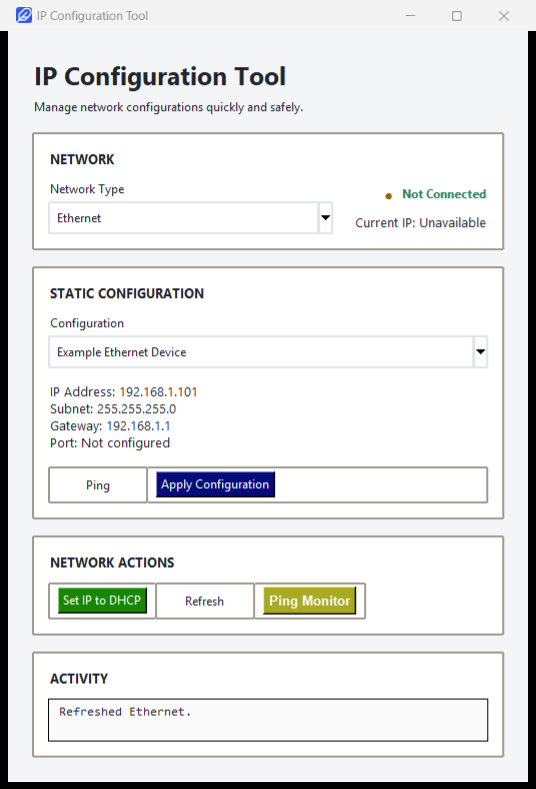
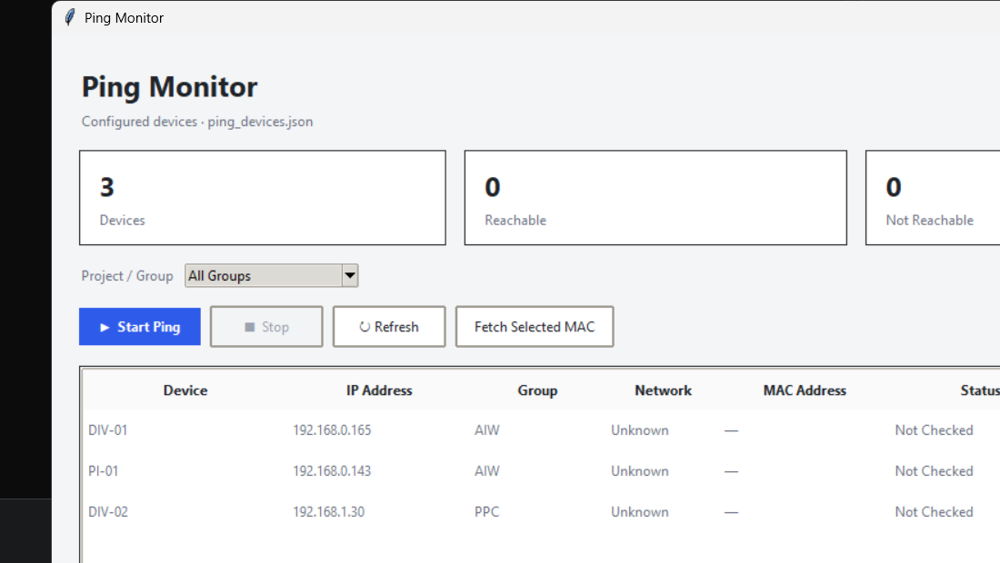

# 🪶 Feather: IP Configuration Tool

**Feather** is a lightweight, user-friendly Windows desktop application that simplifies network IP configuration management. Say goodbye to navigating complex Windows networking panels—Feather gives you instant, one-click control over your Ethernet and Wi-Fi IP settings.


<p align="center">
  
</p>

---

## Table of Contents
1. [Screenshots](#screenshots)
2. [How It Works](#how-it-works)
3. [Key Features](#key-features)
4. [Industry Applications](#industry-applications)
5. [Use Cases by Sector](#use-cases-by-sector)
6. [Benefits](#benefits)
7. [Installation & Setup](#installation--setup)
8. [Configuration Guide](#configuration-guide)

---

## Screenshots

### Main Window — Apply a configuration in one click

<p align="center">
  
</p>

Pick Ethernet or Wi-Fi, see the live connection status and current IP, choose a
saved profile, ping it, then apply it or revert to DHCP. Every action is written
to the activity log at the bottom of the window.

### Ping Monitor — Keep an eye on your devices

<p align="center">
  
</p>

Continuously ping a list of devices, group them, and see reachability, response
time and packet size update live.

---

## How It Works

Feather streamlines the IP configuration process into simple, intuitive steps:

### Workflow Overview

```
┌─────────────────────────────────────────────────────────────┐
│  1. LAUNCH                                                  │
│  Start Feather (opens instantly, no UAC prompt)             │
└────────────────┬────────────────────────────────────────────┘
                 ↓
┌─────────────────────────────────────────────────────────────┐
│  2. SELECT NETWORK TYPE                                     │
│  Choose between Ethernet or Wi-Fi adapter                   │
└────────────────┬────────────────────────────────────────────┘
                 ↓
┌─────────────────────────────────────────────────────────────┐
│  3. VIEW CURRENT STATUS                                     │
│  See current IP, subnet, gateway, and connection status     │
└────────────────┬────────────────────────────────────────────┘
                 ↓
┌─────────────────────────────────────────────────────────────┐
│  4. SELECT A CONFIGURATION                                  │
│  Pick one of your saved profiles                            │
└────────────────┬────────────────────────────────────────────┘
                 ↓
┌─────────────────────────────────────────────────────────────┐
│  5. PREVIEW & VERIFY (Optional)                             │
│  Ping the target IP to verify connectivity before applying  │
└────────────────┬────────────────────────────────────────────┘
                 ↓
┌─────────────────────────────────────────────────────────────┐
│  6. APPLY CONFIGURATION                                     │
│  Set static IP or revert to DHCP with one click             │
└────────────────┬────────────────────────────────────────────┘
                 ↓
┌─────────────────────────────────────────────────────────────┐
│  7. CONFIRM SUCCESS                                         │
│  Feather verifies the change and logs the action            │
└─────────────────────────────────────────────────────────────┘
```

### Behind the Scenes
- **Direct Windows Integration**: Uses native Windows networking APIs (no dependency on `ncpa.cpl`)
- **Real-Time Monitoring**: Displays live connection status and network information
- **Built-in Ping Testing**: Verify device connectivity before or after configuration changes
- **Activity Logging**: Track all configuration changes for audit trails
- **Admin Handling**: Automatically requests administrator privileges when needed

---

## Key Features

### 🎯 Core Capabilities

| Feature | Description |
|---------|-------------|
| **Multi-Network Support** | Configure Ethernet and Wi-Fi adapters independently |
| **Profile Management** | Save unlimited IP configurations with custom names |
| **One-Click Apply** | Switch between saved configurations instantly |
| **DHCP Toggle** | Revert to automatic IP assignment with a single click |
| **Network Monitoring** | Live connection status with the current IP |
| **Ping Testing** | Built-in ping utility to verify device connectivity |
| **Change Detection** | Identifies when a configuration is already active |
| **Activity Log** | History of every change made in the session |
| **Ping Monitor** | Continuously watch a list of devices and their response times |
| **Fast Startup** | Opens in about a second, no unpacking delay |
| **No Internet Needed** | Everything runs locally, offline |

### 💾 Configuration Storage

Configurations are stored as JSON, per user, in `%LOCALAPPDATA%\IPConfigurationTool\config.json`
(the copies shipped in the repository are only first-run seeds, so the app also
works from read-only locations). Each entry has the following structure:

```json
{
  "configurations": [
    {
      "name": "Office Network",
      "network": "Ethernet",
      "ip": "192.168.1.101",
      "subnet": "255.255.255.0",
      "gateway": "192.168.1.1",
      "port": ""
    }
  ]
}
```

---

## Industry Applications

Feather solves real-world networking challenges across multiple industries. Here's how:

### 🏭 **Manufacturing & Industrial IoT**
**Challenge**: Shop floor machines require frequent network reconfigurations when moving between production lines.

**Feather's Solution**:
- Store IP profiles for each production station
- Technicians switch configurations instantly without downtime
- Verify connectivity via built-in ping before resuming operations
- Maintain detailed logs for compliance audits

**Example**: A factory operator switches between Line A (192.168.10.50) and Line B (192.168.10.51) in seconds.

---

### 🏥 **Healthcare & Medical Devices**
**Challenge**: Medical devices need strict network isolation and frequent IP changes across different departments.

**Feather's Solution**:
- Manage separate profiles for Radiology, Cardiology, Surgery departments
- Ensure HIPAA-compliant network segregation
- Quick IP switching for mobile medical equipment
- Automatic logging for compliance requirements

**Example**: A portable ultrasound machine uses saved profiles to switch between departments without IT intervention.

---

### 🏢 **Corporate & Enterprise**
**Challenge**: Employees rotate between offices, lab environments, and remote setups with different network requirements.

**Feather's Solution**:
- Headquarters, branch office, and lab network profiles
- IT can pre-configure devices and distribute via shared config files
- Employees switch networks with zero technical knowledge
- Centralized activity logging for IT security teams

**Example**: A laptop automatically switches from corporate office (DHCP) to lab network (static IP 192.168.50.X) with one click.

---

### 🔬 **Research & Academic Institutions**
**Challenge**: Research labs need to connect to multiple specialized networks (test rigs, simulation servers, data centers).

**Feather's Solution**:
- Save profiles for each lab station and instrument network
- Researchers switch environments without system administration
- Built-in ping testing ensures instrument connectivity
- Maintain detailed records of network changes for reproducibility

**Example**: A PhD student switches a computer between the ML training cluster network and the simulation lab network during experiments.

---

### 🔧 **IT Support & System Administration**
**Challenge**: Support technicians manage multiple networks and need rapid diagnostics and reconfigurations.

**Feather's Solution**:
- Quick network switching for troubleshooting
- Built-in ping and status monitoring for diagnostics
- Activity log provides audit trail for support tickets
- No need to explain complex networking interfaces to remote users

**Example**: A field technician deployed to a client site configures the laptop for the client's network, tests connectivity, and logs the action in seconds.

---

### 🎓 **Education & Training Centers**
**Challenge**: Computer labs need frequent configuration changes for different courses and student groups.

**Feather's Solution**:
- Separate profiles for different lab environments
- Students or instructors switch networks without admin knowledge
- Standardized configurations ensure consistency across machines
- Quick setup reduces lab startup time

**Example**: A computer lab switches 30 machines from the General CS network to the Networking Course network in batch via pre-configured profiles.

---

### 🚗 **Automotive & Fleet Management**
**Challenge**: Diagnostic equipment needs to connect to different vehicle test rigs and networks.

**Feather's Solution**:
- Save profiles for each test stand and diagnostic network
- Mechanics switch equipment between different workstations instantly
- Verify connectivity before running diagnostics
- Log diagnostic sessions for warranty and service records

**Example**: A diagnostic scanner switches from the Transmission Test Stand network to the Engine Test Bench network while running comprehensive vehicle diagnostics.

---

## Use Cases by Sector

### Manufacturing
- ✅ Production line equipment IP rotation
- ✅ IoT sensor network switching
- ✅ Compliance documentation and audit trails
- ✅ Multi-floor facility network management

### Healthcare
- ✅ Medical device network segregation
- ✅ Mobile equipment IP management
- ✅ HIPAA-compliant network isolation
- ✅ Emergency department equipment swaps

### Education
- ✅ Computer lab automation
- ✅ Student project network switching
- ✅ Faculty research network access
- ✅ Standardized lab setup

### Enterprise IT
- ✅ Remote office configuration
- ✅ Employee onboarding automation
- ✅ Test environment switching
- ✅ Disaster recovery network reconfiguration

### Development & Testing
- ✅ Development/staging/production network switching
- ✅ Continuous integration environment management
- ✅ Multi-tenant network isolation
- ✅ Performance testing network profiles

### Field Service & Support
- ✅ On-site technician equipment configuration
- ✅ Mobile service vehicle network setup
- ✅ Quick troubleshooting and diagnostics
- ✅ Service call documentation

---

## Benefits

### ⚡ **Speed**
- Change network configurations in under 5 seconds
- Eliminate manual Windows networking panel navigation
- Reduce setup time for new devices by 80%

### 🎯 **Reliability**
- Native Windows networking commands for compatibility
- Confirmation dialog before every IP change
- Built-in verification shows the new IP after applying

### 👥 **Ease of Use**
- Intuitive graphical interface—no command line knowledge required
- One-click configuration switching
- Non-technical users can manage network settings independently

### 📊 **Compliance & Auditability**
- Complete activity logs for regulatory requirements
- Timestamp every configuration change
- Export-ready audit trails

### 💰 **Cost Efficiency**
- Reduce IT support tickets by automating network switching
- Minimize device downtime from network reconfigurations
- Lightweight tool—minimal system resources

### 🔐 **Security**
- Local configuration management—no cloud dependencies
- Works offline with zero internet required
- Admin privilege handling prevents unauthorized changes
- Network segregation support for sensitive environments

### 🛠️ **Flexibility**
- Unlimited custom configuration profiles
- Support for both static and DHCP modes
- Optional port tracking for application management
- Offline operation for air-gapped networks

---

## Installation & Setup

### System Requirements
- **OS**: Windows 10 or later
- **RAM**: 50MB minimum
- **Disk Space**: 100MB for installation
- **Privileges**: Administrator access required

### Quick Start (Python)

1. **Install Python 3.x** (if not already installed)

2. **Clone the Repository**
   ```bash
   git clone https://github.com/sairam-rumala/Feather.git
   cd Feather
   ```

3. **Install Dependencies**
   ```bash
   pip install -r requirements.txt
   ```

4. **Run the Application**
   ```bash
   python main.py
   ```
   Administrator privileges are requested only when you apply a configuration
   or switch the adapter to DHCP.

### Standalone EXE Build (No Python Required)

1. **Open Command Prompt in the project directory**

2. **Run the Build Script**
   ```bash
   build_windows.bat
   ```

3. **Find Your Executable**
   - Location: `dist/IP Configuration Tool/IP Configuration Tool.exe`
   - Ship the whole `IP Configuration Tool` folder (zip it), not the `.exe` alone
   - No Python installation needed to run
   - Starts in about a second; a single-file build has to unpack itself on every launch

### Distribution
- Share the `dist/IP Configuration Tool/` folder (zipped) with colleagues
- Settings live per user in `%LOCALAPPDATA%\IPConfigurationTool` (`config.json`
  and `ping_devices.json`); the copies in the repo are first-run seeds
- Pre-load configurations in `config.json` for consistent setups
- Update all instances with new configurations centrally

---

## Configuration Guide

### Creating a Configuration Profile

Profiles live in `config.json`. In the installed app that file is
`%LOCALAPPDATA%\IPConfigurationTool\config.json` (created on first run); when
running from source it is the `config.json` in the project folder. Add an entry
to the `configurations` array:

```json
{
  "configurations": [
    {
      "name": "My Network",
      "network": "Ethernet",
      "ip": "192.168.1.100",
      "subnet": "255.255.255.0",
      "gateway": "192.168.1.1",
      "port": "8080"
    },
    {
      "name": "Lab Network",
      "network": "Wi-Fi",
      "ip": "10.0.0.50",
      "subnet": "255.255.255.0",
      "gateway": "10.0.0.1",
      "port": ""
    }
  ]
}
```

### Best Practices

| Practice | Benefit |
|----------|---------|
| Use **descriptive names** | Quickly identify network purpose |
| **Backup config.json** | Prevent accidental configuration loss |
| **Test with ping** | Verify connectivity before production use |
| **Use DHCP sparingly** | Keep static profiles for consistency |
| **Regular log reviews** | Monitor network changes for security |
| **Version control** | Track configuration changes over time |

---

## Advanced Features

### Activity Logging
Feather maintains a complete log of all configuration changes:
- Timestamp of every IP change
- Before and after IP configurations
- User actions (apply, revert, test)
- Success/failure status

### Ping Monitoring
Built-in connectivity testing:
- Verify device before applying configuration
- Test gateway accessibility
- Monitor device response times
- Troubleshoot network issues quickly

### Multi-Network Management
- Independent Ethernet and Wi-Fi profiles
- Switch between network types on the same device
- Maintain separate configurations per adapter

---

## Real-World Example: Manufacturing Floor

**Scenario**: A manufacturing facility has 3 assembly lines, each requiring different network configurations.

**Setup**:
```json
{
  "configurations": [
    {
      "name": "Assembly Line A - Ethernet",
      "network": "Ethernet",
      "ip": "192.168.10.100",
      "subnet": "255.255.255.0",
      "gateway": "192.168.10.1",
      "port": "5000"
    },
    {
      "name": "Assembly Line B - Ethernet",
      "network": "Ethernet",
      "ip": "192.168.20.100",
      "subnet": "255.255.255.0",
      "gateway": "192.168.20.1",
      "port": "5000"
    },
    {
      "name": "Assembly Line C - Ethernet",
      "network": "Ethernet",
      "ip": "192.168.30.100",
      "subnet": "255.255.255.0",
      "gateway": "192.168.30.1",
      "port": "5000"
    }
  ]
}
```

**Workflow**:
1. **Monday**: Equipment moves to Line A → Operator selects "Assembly Line A" → Feather applies configuration in 3 seconds
2. **Wednesday**: Equipment moves to Line B → Operator selects "Assembly Line B" → Configuration switched instantly
3. **Friday**: Equipment returns to Line C → Operator selects "Assembly Line C" → No downtime
4. **Audit**: Management reviews activity log showing all network changes with timestamps

**Result**: Zero IT intervention, 100% uptime, complete compliance documentation.

---

## Frequently Asked Questions

**Q: Does Feather require internet connection?**  
A: No. Feather works completely offline.

**Q: Can I use Feather on non-Windows systems?**  
A: Currently, Feather is Windows-only due to Windows-specific network APIs.

**Q: What happens if I make a mistake?**  
A: You can always revert using the GUI. Edit config.json to undo changes or restart with DHCP mode.

**Q: Can I share configurations with team members?**  
A: Yes! Share the `config.json` file. Team members copy it to their installation and restart Feather.

**Q: Is there a limit to how many configurations I can create?**  
A: No practical limit. Store as many profiles as needed.

**Q: Does Feather work with VPN networks?**  
A: Yes. Feather manages adapter IP configurations, compatible with VPN overlays.

---

## Support & Contributions

- **Repository**: https://github.com/sairam-rumala/Feather
- **Issues**: Report bugs and request features on GitHub
- **Contributions**: Pull requests welcome!

---

## Summary

Feather is the ideal solution for:
- ✅ Professionals managing multiple network environments
- ✅ Organizations requiring rapid network switching
- ✅ Industries with strict compliance and audit requirements
- ✅ Anyone tired of navigating Windows networking panels

**Get started today** and experience the simplicity of one-click network configuration.

---

*Feather v1.0 — Lightweight. Powerful. Essential.*
